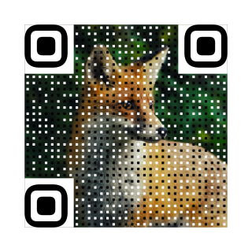

# Quter

[](https://www.npmjs.com/package/@winkcor/quter)


[](https://bundlephobia.com/package/%40winkcor%2Fquter)

Create styled QR codes with React, Vue, Angular, React Native, or plain
JavaScript. Browser apps can blend artwork into a QR code. All adapters support
custom dot styles, finder corners, colors, and an optional center logo.

## Demo

Try the [Quter demo](https://quter.package.hearlin.com) or visit
[Quter on npm](https://www.npmjs.com/package/@winkcor/quter).

## Before and after

| Normal QR with Quter logo | Fox image QR |
| --- | --- |
|  |  |

The image QR uses rounded dots, black extra-rounded finder corners, and white
finder backgrounds. The fox photo is artwork, not the logo.

Fox photo by [Yuriy Chemerys](https://unsplash.com/@ychemerys?utm_source=unsplash&utm_medium=referral&utm_content=creditCopyText) on [Unsplash](https://unsplash.com/photos/selective-focus-photography-of-orange-fox-during-daytime-BTzQWyRK474?utm_source=unsplash&utm_medium=referral&utm_content=creditCopyText).

## Contents

- [Install](#install)
- [Browser](#browser)
  - [Use directly from a browser](#use-directly-from-a-browser)
- [Frameworks](#frameworks)
  - [React](#react)
  - [Vue](#vue)
  - [Angular](#angular)
  - [React Native](#react-native)
  - [Capacitor](#capacitor)
- [Plain JavaScript](#plain-javascript)
- [CLI](#cli)
- [Options](#options)
- [Credits](#credits)
- [License](#license)

## Install

```sh
npm install @winkcor/quter
```

Use the section for your app below. Install only the framework dependencies
your app needs.

## Browser

### Use directly from a browser

Import the standalone ESM build from unpkg without a bundler:

```html
<div id="qr"></div>
<script type="module">
  import { renderQuter } from 'https://unpkg.com/@winkcor/quter/dist/vanilla.mjs';

  renderQuter(document.querySelector('#qr'), {
    value: 'https://github.com/winkcor/quter',
    size: 240,
  });
</script>
```

The browser-ready global build is also available at
[`https://unpkg.com/@winkcor/quter/dist/vanilla.global.js`](https://unpkg.com/@winkcor/quter/dist/vanilla.global.js).

## Frameworks

### React

Requires React 18 or newer. Import from `@winkcor/quter`.

```tsx
import Quter from '@winkcor/quter';

export function App() {
  return (
    <Quter
      value="https://github.com/winkcor/quter"
      imagePath="/images/artwork.jpg"
      size={280}
      dotStyle="rounded"
      dotGradient={{ startColor: '#6546df', endColor: '#19b8a6', angle: 45 }}
      corner={{
        square: { style: 'extra-rounded', color: '#087f83' },
        dot: { style: 'circle', color: '#087f83' },
      }}
      logo={{ src: '/images/logo.png', size: 0.25, aspectRatio: 1 }}
      ariaLabel="QR code for example.com"
    />
  );
}
```

`imagePath` blends artwork into the QR code. `logo.src` adds a separate center
logo.

### Vue

Requires Vue 3.5 or newer. Import `Quter` from `@winkcor/quter/vue`.

```vue
<script setup>
import { Quter } from '@winkcor/quter/vue';
</script>

<template>
  <Quter value="https://github.com/winkcor/quter" image-path="/images/artwork.jpg" />
</template>
```

### Angular

Requires Angular 18 or newer. The renderer returns a cleanup function; call it
when the component is destroyed.

```ts
import { AfterViewInit, Component, ElementRef, OnDestroy, ViewChild } from '@angular/core';
import { renderAngularQuter } from '@winkcor/quter/angular';

@Component({ selector: 'app-qr', template: '<div #qr></div>' })
export class QrComponent implements AfterViewInit, OnDestroy {
  @ViewChild('qr', { static: true }) qr!: ElementRef<HTMLElement>;
  private stop?: () => void;

  ngAfterViewInit() {
    this.stop = renderAngularQuter(this.qr, { value: 'https://github.com/winkcor/quter' });
  }

  ngOnDestroy() {
    this.stop?.();
  }
}
```

### React Native

Requires React Native 0.72 or newer and `react-native-svg` 15 or newer.

```sh
npm install @winkcor/quter react-native-svg
```

Expo apps can use `npx expo install react-native-svg` to select a compatible
version. Import from `@winkcor/quter/react-native`.

```tsx
import Quter from '@winkcor/quter/react-native';

export function App() {
  return (
    <Quter
      value="https://github.com/winkcor/quter"
      size={280}
      dotStyle="rounded"
      logo={{ source: require('./assets/logo.png'), size: 0.25 }}
      ariaLabel="QR code for example.com"
    />
  );
}
```

The logo source can be a local `require(...)` asset or a React Native image
source. Set `logo.aspectRatio` for a non-square logo. Image blending with
`imagePath` is not available in React Native.

### Capacitor

Capacitor displays your web app in a WebView. Use the section above that matches
your app's web framework; no Capacitor-specific plugin is needed. Browser
features, including `imagePath`, are available.

## Plain JavaScript

For browser apps without a framework, import `renderQuter` from `@winkcor/quter/vanilla`.
Call the returned function to stop rendering and clean up.

```html
<div id="qr"></div>
<script type="module">
  import { renderQuter } from '@winkcor/quter/vanilla';

  const stop = renderQuter(document.querySelector('#qr'), {
    value: 'https://github.com/winkcor/quter',
    imagePath: '/images/artwork.jpg',
  });
</script>
```

## CLI

Generate a normal SVG QR code with a center logo:

```sh
npx @winkcor/quter "https://github.com/winkcor/quter"" --logo ./logo.svg --output qr-logo.svg
```

Blend an image into the QR code:

```sh
npx @winkcor/quter "https://github.com/winkcor/quter"" --image ./photo.jpg --image-dot-size 0.4 --size 320 --dot-style rounded --output qr-image.svg
```

Replace `./logo.svg` and `./photo.jpg` with image files on your computer.

Without `--output`, the SVG is written to standard output:

```sh
npx @winkcor/quter "https://github.com/winkcor/quter" > qr.svg
```

Run `npx @winkcor/quter --help` to see all available options.

## Options

- `value` — text or URL to encode.
- `size` — output size in pixels; defaults to `256`.
- `dotStyle` — `square`, `circle`, or `rounded`.
- `dotColor` / `dotGradient` — module color or a linear gradient with
  `startColor`, `endColor`, and optional `angle`.
- `backgroundColor` / `backgroundGradient` — background color or gradient.
- `corner` — optional `backgroundColor` fills behind all finder patterns;
  it defaults to the QR background (white by default). Set it to `"transparent"`
  to show image artwork through the finder background. Finder-pattern `square`
  and `dot` each accept `style`, `color`, and `gradient`.
- `logo` — optional center logo. Its `size` is a fraction from `0` to `1`;
  `margin`, `radius`, `hideDots`, and `aspectRatio` customize its placement.
- `qr` — QR settings, including `errorCorrectionLevel` and `version`.
- `imagePath` — browser-only artwork blended into the QR code. Customize with
  `imageDotStyle`, `imageDotSize`, `imageColor` (or `filter`), `imageGapColor`
  (an optional color/alpha overlay between dots), and `fillType`.

Use high contrast and test the finished QR code with the scanners and at the
size where it will be displayed. Large logos and decorative styles can reduce
scan reliability.

## Credits

The QR encoding and geometry core is adapted from
[`@ttsalpha/qrcode`](https://github.com/ttsalpha/qrcode) v3.1.0 by Son Tran.
The project was also inspired by [qart.js](https://github.com/kciter/qart.js).
See [`THIRD_PARTY_NOTICES.md`](./THIRD_PARTY_NOTICES.md) for the license notice.

## License

MIT
